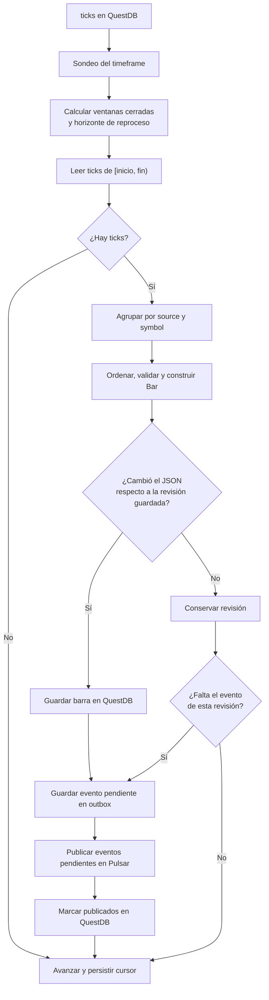

# Lógica y estructura del Aggregator

Este documento describe la lógica actual de `bin/aggregator` y el contrato JSON
versión 4 de `Bar`, serializado por `src/model.rs`. Cada proceso trabaja con un
timeframe configurado; el mismo esquema se usa para todos ellos. Las barras se
guardan como JSON en QuestDB y se incluyen en `data` de los eventos enviados a
Pulsar.

La versión 4 no es compatible en el wire format con la versión 3: añade
`timeframe` a la barra e identidad, y `active_seconds` cuenta segundos UTC
distintos con actividad en toda la barra. La versión 3 introdujo enteros grandes
como cadenas decimales, renombró `returns` a `price_changes` y agregó
`raw_ticks[].time_us`.

## Arquitectura y flujo de ejecución

### Módulos

- `src/main.rs`: inicializa conexiones y registro de IDs, mantiene el ciclo de
  sondeo, recorre ventanas cerradas y coordina la persistencia y el despacho a
  Pulsar.
- `src/model.rs`: define `Tick`, `Bar` y sus estructuras anidadas; ordena y
  valida los ticks, calcula métricas, footprint, distribuciones, integridad y
  checksum.
- `src/persistence.rs`: crea/verifica el esquema QuestDB, lee ticks y barras
  existentes, guarda barras, cursor y outbox, y recupera eventos pendientes.
- `src/registry.rs`: asigna IDs numéricos estables a fuentes y símbolos y los
  guarda en un archivo JSON por timeframe.
- `src/config.rs`: carga `.env.dev` y variables de entorno, valida opciones y
  resuelve duración y rutas específicas del timeframe.

### Flujo



Al arrancar, el servicio despacha primero eventos pendientes para recuperar
trabajo de una ejecución anterior. El cursor de QuestDB indica la siguiente
ventana por procesar; si todavía no existe, se inicializa desde el primer tick.
Cada ciclo recorre ventanas cerradas hasta el límite de lateness permitido y
vuelve a examinar las ventanas dentro de `REPROCESS_MINUTES` (redondeadas a
ventanas completas, con al menos la última ventana cerrada). Esto permite
corregir barras afectadas por ticks tardíos.

Las ventanas son UTC y semiabiertas: `[inicio, fin)`. Una ventana sin ticks no
genera barras, pero sí puede avanzar el cursor. Una ventana con datos se divide
por `(source, symbol)`; cada grupo produce una barra independiente.

### Revisiones, almacenamiento y entrega

El agregador compara el JSON recalculado con el payload persistido. Si cambió,
incrementa `revision`, actualiza la barra y crea un evento nuevo; si no cambió,
reutiliza la revisión y evita duplicar el evento cuando ya está en el outbox.
La clave de barra es
`{source}/{symbol}/{timeframe}/{timestamp_ms}` y el ID de evento agrega
`:r{revision}`.

La barra y el evento pendiente se escriben en QuestDB con confirmación durable,
en escrituras separadas. Después, los eventos del outbox se publican en Pulsar y
se marcan como publicados. QuestDB y Pulsar no comparten una transacción: la
entrega es al menos una vez, así que puede haber duplicados si el proceso cae
después de publicar y antes de registrar la confirmación. Los consumidores deben
hacer idempotencia con `event_id`.

Cada timeframe aísla sus tablas, cursor, outbox, registro de IDs y directorio
store-and-forward. Para `1m` se conservan los nombres históricos (`bars_1m`,
`bar_events`, `aggregator_state`); los demás timeframes usan nombres con sufijo,
por ejemplo `bars_5m`, `bar_events_5m` y `aggregator_state_5m`. Debe ejecutarse
una sola instancia activa por timeframe y base de datos.

## Construcción de una barra

`build_bar_for_timeframe` exige al menos un tick, una duración positiva, source
y symbol no vacíos y consistentes, timestamps no negativos y todos los ticks
dentro de la misma ventana. Ordena por `time_us`; para timestamps iguales ordena
IDs numéricos por valor (y luego por texto original), antes que IDs no numéricos,
que se ordenan lexicográficamente.

Con el orden canónico calcula OHLC y cambios de precio, conteos y flujos de
compra/venta, niveles de footprint, estadísticas de tamaño, interarribos,
perfiles e histogramas, métricas de microestructura, indicadores de integridad
y checksum. Los ticks originales ordenados se conservan en `raw_ticks` para
auditoría. Los precios y cantidades de entrada son enteros escalados por `10^8`;
el notional es su producto entero. El cálculo usa operaciones comprobadas para
detectar desbordamientos y enteros grandes cuando los momentos exceden 128 bits.

## Tick de entrada

La tabla `ticks` proporciona estos campos:

```text
"time","source","symbol","id","price","qty","is_buyer_maker"
"2026-11-23T00:05:30.104000Z","binance","BTCUSDT","8322178460",6117280000000,8100000,1
"2026-11-23T00:05:30.161000Z","binance","BTCUSDT","8322178461",6117290000000,100000,0
```

Los ticks se ordenan por `time_us` y después por un orden total del ID: los IDs
que se pueden interpretar como `u64` preceden a los de texto; los numéricos se
ordenan por valor y luego por texto original (por ejemplo, `"02"` precede a
`"2"`); los de texto, lexicográficamente. Cada barra representa una ventana UTC
semiabierta `[inicio, fin)`. Las duraciones soportadas son `1m`, `5m`, `15m`,
`30m`, `1h`, `4h` y `1d`. Solo se crea una barra si la ventana contiene al menos
un tick.

## Grafo del contenido de `Bar` (esquema JSON)

El siguiente árbol muestra la estructura anidada serializada por `Bar`. Los
nombres y tipos son los del modelo Rust. En JSON, cada `i64`, `u64`, `i128` y
`u128` se serializa como cadena decimal exacta, incluidos los elementos de
arreglos de `u64`; `u8`, `u16` y `u32` siguen siendo números JSON. `String` se
serializa como cadena y los vectores como arreglos. Esta política evita pérdida
de precisión en JavaScript y otros consumidores basados en binary64.

```text
Bar
├── schema_version              u16
├── timestamp                   u64
├── source                      String
├── symbol                      String
├── timeframe                   String (timeframe configurado en el worker)
├── revision                    u64
├── bar_key                     String
├── header
│   ├── schema_version          u16
│   ├── timestamp               u64
│   ├── symbol_id               u16
│   ├── source_id               u8
│   ├── flags                   u32
│   ├── aggregation_level       u8
│   ├── price_scale             u8
│   ├── quantity_scale          u8
│   └── time_unit               u8
├── identity
│   ├── first_trade_id           u64
│   ├── last_trade_id            u64
│   ├── first_trade_id_raw       String
│   ├── last_trade_id_raw        String
│   ├── trade_ids_numeric        u8
│   ├── n_trades                 u64
│   ├── first_event_ts           u64
│   ├── last_event_ts            u64
│   ├── first_receive_ts         u64
│   ├── last_receive_ts          u64
│   ├── coverage_flags           u32
│   └── sequence_contiguous      u8
├── price
│   ├── open                     i64
│   ├── high                     i64
│   ├── low                      i64
│   ├── close                    i64
│   ├── upticks                  u64
│   ├── downticks                u64
│   ├── zero_ticks               u64
│   ├── direction_changes        u64
│   ├── first_price_change       i64
│   ├── last_price_change        i64
│   ├── max_price_change         i64
│   └── min_price_change         i64
├── volume_flow
│   ├── total_qty                u128
│   ├── total_notional           u128
│   ├── buy_qty                  u128
│   ├── sell_qty                 u128
│   ├── buy_notional             u128
│   ├── sell_notional            u128
│   ├── signed_qty               i128
│   ├── signed_notional          i128
│   ├── buy_count                u64
│   ├── sell_count               u64
│   ├── max_trade_qty            u128
│   ├── max_trade_notional       u128
│   └── vwap                     u128
├── footprint
│   ├── level_count              u32
│   ├── poc_price                i64
│   ├── poc_volume               u128
│   ├── poc_delta                i128
│   ├── value_area_high          i64
│   ├── value_area_low           i64
│   ├── max_positive_delta       i128
│   ├── max_negative_delta       i128
│   ├── imbalance_count          u32
│   ├── stacked_buy_imbalance    u32
│   ├── stacked_sell_imbalance   u32
│   ├── unfinished_auction_high  u8
│   ├── unfinished_auction_low   u8
│   └── levels[]                 FootprintLevel
│       ├── price                i64
│       ├── buy_qty              u128
│       ├── sell_qty             u128
│       ├── buy_notional         u128
│       ├── sell_notional        u128
│       ├── buy_count            u32
│       ├── sell_count           u32
│       ├── delta                i128
│       ├── total_qty            u128
│       ├── total_count          u32
│       └── flags                u16
├── price_changes
│   ├── change_count             u64
│   ├── first_change             i64
│   ├── last_change              i64
│   ├── change_sum               i128
│   ├── change_sum_sq            String
│   ├── change_sum_cu            String
│   ├── change_sum_qu            String
│   ├── realized_variance        String
│   ├── bipower_variation        String
│   ├── positive_change_magnitude u128
│   ├── negative_change_magnitude u128
│   ├── max_change               i64
│   └── min_change               i64
├── trade_size_statistics
│   ├── size_sum                 u128
│   ├── size_sum_sq              String
│   ├── size_sum_cu              String
│   ├── size_sum_qu              String
│   ├── max_size                 u128
│   ├── min_size                 u128
│   └── mean_size                u128
├── timing
│   ├── first_interarrival       u64
│   ├── last_interarrival        u64
│   ├── min_interarrival         u64
│   ├── max_interarrival         u64
│   ├── sum_interarrival         u128
│   ├── sum_interarrival_sq      u128
│   ├── interarrival_count       u64
│   ├── active_seconds           u32
│   └── activity_profile         u32[60]
├── distributions
│   ├── trade_size_hist          u64[16]
│   ├── trade_size_hist_min      i128
│   ├── trade_size_hist_max      i128
│   ├── price_change_hist        u64[16]
│   ├── price_change_hist_min    i128
│   ├── price_change_hist_max    i128
│   ├── interarrival_hist        u64[16]
│   ├── interarrival_hist_min    i128
│   ├── interarrival_hist_max    i128
│   ├── price_volume_hist        u64[16]
│   ├── price_volume_hist_min    i128
│   └── price_volume_hist_max    i128
├── microstructure
│   ├── trade_imbalance          i128
│   ├── volume_imbalance         i128
│   ├── notional_imbalance       i128
│   ├── buy_trade_ratio          u64
│   ├── sell_trade_ratio         u64
│   ├── trade_intensity          u64
│   ├── average_trade_size       u128
│   ├── price_efficiency         i64
│   ├── absorption_buy           u128
│   ├── absorption_sell          u128
│   ├── exhaustion_buy           u128
│   └── exhaustion_sell          u128
├── integrity
│   ├── sequence_gaps            u64
│   ├── duplicate_count          u64
│   ├── out_of_order_count       u64
│   ├── invalid_trade_count      u64
│   ├── dropped_trade_count      u64
│   ├── expected_trade_count     u64
│   ├── received_trade_count     u64
│   ├── quality_flags            u32
│   └── checksum                 u64
└── raw_ticks[]                  RawTick
    ├── time                     u64
    ├── time_us                  i64
    ├── source                   String
    ├── symbol                   String
    ├── id                       String
    ├── price                    u64
    ├── qty                      u64
    └── is_buyer_maker           u8
```

## Sobre JSON, identidad y versiones

- `event_id` no forma parte de `Bar`: es un campo del sobre Pulsar, junto con
  `event_type`, `timestamp`, `source`, `symbol`, `timeframe`, `revision` y
  `data`. `event_type` vale `bar.{timeframe}`. El `timestamp` y `revision` del
  sobre son cadenas decimales JSON, igual que los campos correspondientes de la
  barra.
- `bar_key` tiene el formato
  `"{source}/{symbol}/{timeframe}/{timestamp_ms}"`. `event_id` añade
  `:r{revision}`. La revisión comienza en 1 y aumenta cuando cambia una barra
  recalculada.
- Los campos raíz `schema_version` y `timestamp` son autoritativos; se copian en
  `header` para que el consumidor pueda validar que coinciden. De igual manera,
  el timestamp y la revisión del sobre reflejan `data.timestamp` y
  `data.revision`.
- `timestamp`, `header.timestamp`, `first_event_ts`, `last_event_ts`,
  `raw_ticks[].time` y los timestamps de barra/evento son milisegundos Unix UTC.
  `raw_ticks[].time` trunca a milisegundos el timestamp de entrada; `time_us`
  conserva los microsegundos exactos y se usa en el checksum. Se rechazan
  timestamps negativos. Los interarribos se expresan en microsegundos.
- `first_trade_id_raw` y `last_trade_id_raw` son los IDs originales
  autoritativos. `first_trade_id`/`last_trade_id` contienen el `u64` parseado si
  es posible; en caso contrario, contienen FNV-1a de 64 bits de los bytes UTF-8
  del ID. Esos hashes pueden colisionar: no deben tratarse como IDs originales.
  `trade_ids_numeric` vale 1 solo si todos los IDs se pueden parsear como
  `u64`. El parser de Rust admite un signo `+` inicial (por ejemplo, `"+5"` se
  parsea como 5); se conserva el texto original y se usa para desempatar IDs con
  igual valor numérico.
- `source_id` y `symbol_id` proceden de registros persistentes separados, en
  rutas específicas del timeframe derivadas de `AGGREGATOR_ID_REGISTRY`; se
  asigna el primer ID positivo disponible. Hay que conservar el registro para
  mantener estables los mapeos. `aggregation_level=1` significa agregación
  directa desde ticks; `price_scale` y `quantity_scale` son exponentes decimales
  (ambos 8) y `time_unit=1` significa milisegundos.

## Convenciones de métricas y flags

- `price` y `qty` de entrada son enteros escalados por `10^8`; el notional es su
  producto. Los campos de cambio de precio representan diferencias enteras de
  precio, no retornos porcentuales.
- `buy_trade_ratio` y `sell_trade_ratio` son fracciones del número de trades,
  multiplicadas por `10^8` y calculadas solo sobre trades cuyo lado se conoce;
  ambos valen cero si no hay ninguno. Las 60 posiciones de `activity_profile`
  son segmentos de igual duración de la barra: para `1m`, cada segmento dura un
  segundo; en timeframes mayores, cada segmento cubre la misma fracción del
  timeframe. `active_seconds` cuenta, de forma independiente, los segundos UTC
  distintos que contienen ticks. `trade_intensity` es
  `n_trades * 10^8 / active_seconds`. `price_efficiency` es
  `(close - open) * 10^8 / sum(abs(cambios consecutivos de precio))`, o cero si
  el denominador es cero.
- `is_buyer_maker=0` suma al flujo comprador y `=1` al vendedor. Otros valores se
  conservan en `raw_ticks` y cuentan para `total_qty`/`total_notional`, pero no
  para los totales por lado. Por eso no debe asumirse que
  `total_qty = buy_qty + sell_qty`.
- `footprint.level_count` cuenta todos los precios observados. El `total_qty` de
  cada nivel suma cantidades de compra y venta conocidas; será cero si en ese
  precio solo hubo ticks de lado desconocido. El objetivo del área de valor es
  el 70% de la cantidad con lado conocido (`buy_qty + sell_qty`); las cantidades
  de lado desconocido no afectan el objetivo ni los volúmenes por nivel.
- Los niveles del footprint se ordenan por precio ascendente. Un nivel tiene
  desequilibrio comprador si `buy_qty` es al menos tres veces `sell_qty` (o si
  `sell_qty` es cero y `buy_qty` es positivo); para el vendedor aplica la regla
  simétrica. `stacked_*_imbalance` es la racha más larga de niveles observados
  consecutivos con desequilibrio de ese lado; no es necesario que sus precios
  sean adyacentes por un tick. En `FootprintLevel.flags`, el bit 0 indica
  desequilibrio comprador y el bit 1 vendedor.
- El área de valor se expande desde el punto de control hasta incluir al menos
  el 70% del volumen con lado conocido. En empates de volumen para el punto de
  control se elige el precio menor; en empates durante la expansión, el precio
  mayor. Si no hay volumen con lado conocido, el objetivo es cero y el área se
  queda en el punto de control; debe interpretarse junto con el flag de cobertura
  de lado desconocido.
- Los histogramas tienen 16 bins de igual ancho. Para un valor `x`, el bin es
  `floor((x-min)*16/(max-min))`, limitado al bin 15; si `min=max`, todos los
  valores van al bin 0. `*_min` y `*_max` son extremos observados, no límites de
  bins. `trade_size_hist` cuenta trades por bin de cantidad (no pondera por
  cantidad); `price_change_hist` cuenta cambios consecutivos enteros;
  `interarrival_hist` cuenta interarribos en microsegundos. `price_volume_hist`
  agrupa por precios observados y pondera cada tick por su cantidad original.
  Así, los primeros tres histogramas cuentan observaciones y el último suma
  cantidades por bin.
- `positive_change_magnitude` y `negative_change_magnitude` suman por separado
  las magnitudes absolutas de los cambios positivos y negativos. No son los
  componentes de `realized_variance`, que suma los cambios al cuadrado. Los
  momentos de orden alto se guardan como cadenas decimales exactas porque pueden
  superar 128 bits; en v4, los demás enteros anchos también se serializan como
  cadenas para evitar pérdida de precisión.
- `trade_imbalance`, `volume_imbalance` y `notional_imbalance` son diferencias
  con signo compra menos venta para conteo, cantidad y notional; no son valores
  absolutos. `vwap = total_notional / total_qty`; `mean_size` y
  `average_trade_size` son `size_sum / n_trades`. La división entera trunca
  hacia cero. VWAP conserva la escala de precio de entrada `10^8`.
- `direction_changes` cuenta reversiones entre cambios de precio consecutivos no
  nulos; los cambios cero no reinician la dirección no nula anterior.
  `max_positive_delta` es al menos cero y `max_negative_delta` como máximo cero,
  porque ambos extremos se inicializan en cero.
- `bipower_variation` es la suma sin escalar
  `Σ |change[i]| * |change[i-1]|`; no incluye el factor convencional `π/2`.
  `absorption_buy` es la cantidad compradora conocida total si `close <= open`;
  `absorption_sell`, la cantidad vendedora conocida total si `close >= open`.
  `exhaustion_buy` es la cantidad compradora en el precio máximo si
  `close <= open`; `exhaustion_sell`, la cantidad vendedora en el precio mínimo
  si `close >= open`. Son heurísticas de implementación, no señales de mercado
  validadas independientemente.
- En `header.flags`, el bit 0 indica que hay al menos un flag de cobertura. El
  bit 1 está siempre activo por ahora y reservado; los consumidores no deben
  asignarle otro significado. Los bits de `coverage_flags` son: 0, hora de
  recepción no disponible; 1, al menos un ID no numérico; 2, conteo de
  duplicados previo a ingestión no disponible; 3, orden original de llegada no
  disponible; 4, valor de lado desconocido; 5, conteo esperado no disponible;
  6, conteos de inválidos/descartados no disponibles. Actualmente
  `quality_flags` copia `coverage_flags`.
- `unfinished_auction_high` vale 1 si el nivel de precio máximo tiene cantidad
  vendedora cero; `unfinished_auction_low` vale 1 si el nivel mínimo tiene
  cantidad compradora cero. Son los predicados actuales del código: hay que
  confirmar su interpretación frente a la convención de subasta pretendida
  antes de tratarlos como semántica de mercado. Estos flags y
  `sequence_contiguous` se codifican como 0/1. `sequence_contiguous` vale 1 solo
  si todos los IDs se parsean como `u64` y, ordenados por hora de evento, no
  tienen duplicados numéricos, retrocesos ni huecos.
- `duplicate_count` cuenta IDs repetidos dentro de esta barra después de la
  ingestión. Los IDs numéricos se comparan por valor (`"02"` y `"2"` son
  duplicados); los no numéricos, por texto exacto. No detecta duplicados
  eliminados antes de llegar a `ticks`. `out_of_order_count` cuenta regresiones
  de IDs numéricos en orden de hora de evento, no en el orden original de
  llegada, que la tabla no conserva. `sequence_gaps` cuenta valores faltantes
  entre IDs numéricos adyacentes en esa misma secuencia. Los IDs no numéricos
  interrumpen ambas comparaciones.

## Checksum y cobertura de la fuente

- `checksum` es FNV-1a de 64 bits sobre los ticks en el mismo orden de
  `raw_ticks`. Parte de la base `0xcbf29ce484222325`; para cada tick agrega, en
  orden, `source`, `symbol` e `id` como bytes UTF-8, precedidos cada uno por su
  longitud en bytes como entero unsigned de 64 bits big-endian; luego `time_us`
  como signed de 64 bits big-endian, `price` y `qty` como unsigned de 64 bits
  big-endian, e `is_buyer_maker` como un byte. Para cada byte, lo combina con XOR
  y multiplica con aritmética wrapping por `0x100000001b3`. El resultado es una
  cadena decimal JSON de 64 bits unsigned. Los IDs siempre se codifican como
  texto.
- La tabla `ticks` no contiene timestamps de recepción, orden original de
  llegada, conteo de duplicados previo a deduplicación, conteo esperado de ticks
  ni conteos de ticks rechazados/descartados. Los campos numéricos de esos datos
  no disponibles valen cero; `coverage_flags`/`quality_flags` señalan la falta
  de cobertura.
